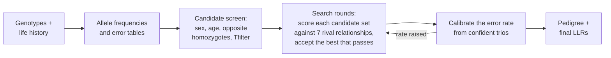

# PaPeR

**Parentage and Pedigree Reconstruction using microhaplotypes and SNPs, in R.**

[](https://github.com/ty-wittman/PaPeR/actions/workflows/R-CMD-check.yaml)
[](LICENSE.md)


PaPeR finds the genotyped dam and/or sire of genotyped
individual in a population, using multiallelic microhaplotype or biallelic
SNP genotypes plus each individual's sex and birth year. It handles
overlapping generations, unsampled parents and genotyping error.

PaPeR is inspired by **[Sequoia](https://CRAN.R-project.org/package=sequoia)**,
Jisca Huisman's pedigree reconstruction package ([Huisman
2017](https://doi.org/10.1111/1755-0998.12665)), and follows its heuristic
approach to parentage. It extends that approach to microhaplotypes: a
microhaplotype locus carries several alleles and much more information than a
single SNP. See
[Relationship to Sequoia](#relationship-to-sequoia) for what is shared and
what differs.

> **Status:** version 0.1.0, research software. Validated on simulated
> pedigrees (see [Validation](#validation)); the interface may still change.

## Highlights

- **Microhaplotypes and SNPs.** Any number of alleles per locus. A
  dropout/foreign error model for microhaplotypes, and Sequoia's error model
  for SNPs.
- **Exact local likelihoods.** Each candidate parent is tested against seven
  alternative relationships (unrelated, full and half sibling, grandparent,
  full and half aunt or uncle, and offspring) by an exact likelihood
  calculation on a local pedigree. That local pedigree includes the parents
  and grandparents already assigned, and deeper ancestry enters through
  genotype messages.
- **Self-calibrating error rate.** PaPeR estimates the genotyping error rate
  from the confident parent–offspring trios it finds. If the data show more
  errors than you assumed, it raises the rate and searches again.
- **Familiar to Sequoia users.** The same life-history format, the same
  assignment thresholds (`Tassign`, `Tfilter`) and Sequoia-style output
  columns (`LLRdam`, `LLRsire`, `LLRpair`, `OHdam`, `OHsire`, `MEpair`).
- **Diagnostics.** Duplicate samples, likely relatives missing from a
  pedigree, marker statistics, and LLRs for any fixed pedigree.
- **Native core.** C++20 through Rcpp. The 595-individual example below,
  with 100 microhaplotypes, runs in about a minute on one CPU core.
- **Tested.** About 3,900 unit-test expectations. They include exact checks
  against brute-force genotype enumeration on small pedigrees, and an
  optional cross-check against the relationship likelihoods of
  [CKMRsim](https://github.com/eriqande/CKMRsim).

## Installation

PaPeR is not on CRAN. Install it from GitHub:

```r
# install.packages("remotes")
remotes::install_github("ty-wittman/PaPeR", build_vignettes = TRUE)
```

You need R 4.4 or later and a C++20 compiler: Rtools on Windows, the Xcode
command-line tools on macOS, or a recent GCC or Clang on Linux.

## Quick start

The package includes a simulated population, `pap_example`: 700 individuals
over six birth years, 595 of them genotyped on 100 microhaplotypes and on 150
SNPs, with the true pedigree.

```r
library(PaPeR)
ex <- pap_example

ped <- assign_parents(ex$GenoM, ex$LifeHistData,
                      Dropout = 0.005, Foreign = 5e-4,
                      control = list(CalcLLR = TRUE))

head(ped[!is.na(ped$dam), c("id", "dam", "sire", "LLRdam", "LLRsire", "OHdam", "OHsire")])
#>         id    dam   sire    LLRdam   LLRsire OHdam OHsire
#> 128 ID0151 ID0021 ID0001 10.683655 10.455248     0      0
#> 129 ID0152 ID0096   <NA>  4.692284        NA     0     NA
#> 130 ID0153 ID0029 ID0078  9.090628  8.176257     0      0
#> 131 ID0154 ID0026 ID0049 11.843881  9.104535     0      1
#> 132 ID0155 ID0079 ID0084 11.587575  8.628948     0      1
#> 133 ID0157 ID0068   <NA>  5.640343        NA     0     NA

# compare with the true pedigree
sc <- score_pedigree(ped, ex$Pedigree, typed_ids = rownames(ex$GenoM))
sapply(sc, function(x) unlist(x[c("assigned", "correct", "wrong", "missed")]))
#>          dam sire
#> assigned 387  400
#> correct  387  400
#> wrong      0    0
#> missed     0    0
```

Every genotyped parent is found, and no parent is assigned where the true
parent was never genotyped. On the 150 SNPs of the same individuals, with
Sequoia's error model, PaPeR finds 383 dams and 396 sires, with one wrong dam:

```r
ped_snp <- assign_parents(ex$GenoM_snp, ex$LifeHistData,
                          control = list(error_model = "sequoia", Err = 0.005))
```

The [getting-started vignette](vignettes/PaPeR.Rmd)
(`vignette("PaPeR")`) goes through marker checks, duplicate detection, error
calibration, final LLRs and how to prepare your own data.

## Your own data

| Input | Format |
|---|---|
| `GenoM` | Character matrix, one row per individual (row names are IDs) and one column per locus. Calls are `"a/b"` with alleles numbered `1..k` at each locus; `"0"` is missing. SNPs use alleles 1 and 2. |
| `LifeHistData` | Data frame with `ID`, `Sex` (1 female, 2 male, 3 or `NA` unknown) and `BirthYear`; optionally `BY.min`, `BY.max` for uncertain birth years and `Year.last`. As in Sequoia. |
| `Dropout`, `Foreign` | Microhaplotype error rates: the chance that a true heterozygote is called as a homozygote, and the chance that an allele copy is replaced by a random allele. Starting values are enough. Foreign should be a tiny positive number |
| `control` | Every other setting; `pap_control()` lists them with their defaults. |

Before running PaPeR on your own data:

- **Number alleles from 1 at each locus.** Genotype callers often write
  allele names, or codes like `101/103`. PaPeR takes the largest number it
  sees as the number of alleles at a locus, so recode first. The vignette has
  a short `recode_alleles()` function.
- **Convert Sequoia's 0/1/2 SNP matrices** to `"1/1"`, `"1/2"`, `"2/2"` and
  `"0"`. The vignette has a one-line converter.
- **Give uncertain birth years as a range** (`BY.min`, `BY.max`) rather than
  a best guess. A wrong exact year can rule out the true parent.
- **Remove duplicate samples** with `find_duplicates()` first.

## Relationship to Sequoia

PaPeR owes its overall design to **Sequoia** by **Jisca Huisman**
([CRAN](https://CRAN.R-project.org/package=sequoia),
[GitHub](https://github.com/JiscaH/sequoia),
[documentation](https://jiscah.github.io/)), described in:

> Huisman, J. (2017). Pedigree reconstruction from SNP data: parentage
> assignment, sibship clustering and beyond. *Molecular Ecology Resources*,
> 17(5), 1009–1024. <https://doi.org/10.1111/1755-0998.12665>

**What PaPeR takes from Sequoia.** PaPeR generally follows Sequoia's
heuristic approach to parentage:

- the search proceeds in rounds over the genotyped individuals, assigning
  parents greedily and building on earlier assignments;
- each parent is accepted only if parent–offspring beats the alternative
  relationships by a likelihood-ratio threshold;
- candidates are screened beforehand by sex, age, opposite homozygotes and a
  quick unconditional test;
- birth years and their ranges limit which individuals can be parents.

It also uses many of Sequoia's input formats, setting names and output columns, and
offers Sequoia's SNP error model as an option when using SNPs. Anyone used to Sequoia should be able to run PaPeR with little relearning.

**How PaPeR differs.** The likelihood machinery is new:

- **Multiallelic markers.** Every likelihood is computed over all `k(k+1)/2`
  genotypes of a `k`-allele locus, with a dropout/foreign error model built
  for microhaplotypes.
- **Exact local pedigree likelihoods.** Each decision is an exact
  variable-elimination calculation on a local pedigree: the focal individual,
  the proposed parents, their assigned parents and grandparents, and the
  unobserved individuals a rival relationship needs. Deeper ancestry enters
  through sum-product genotype messages over a spanning forest of the current
  pedigree. Each rival relationship (seven by default) is an explicit
  pedigree with its own latent individuals.
- **Error-rate calibration.** PaPeR fits the error rate from the
  Mendelian inconsistencies of confident trios and, when needed, raises it and
  restarts the search. Sequoia uses the error rate you supply.
- **Parentage only.** Currently PaPeR only assigned genotype parents to genotyped offspring, full      pedigree reconstruction is in active development but not yet complete or released.

PaPeR is an independent implementation in R and C++ and contains no Sequoia
code.

**Settings side by side**

| Sequoia | PaPeR |
|---|---|
| `sequoia(GenoM, LifeHistData, Module = "par")` | `assign_parents(GenoM, LifeHistData, Dropout, Foreign)` |
| `Err` | `control = list(error_model = "sequoia", Err = ...)` for SNPs |
| `Tassign`, `Tfilter` | `control$Tassign`, `control$Tfilter` (same defaults) |
| `args.AP = list(MinAgeParent, MaxAgeParent)` | `control$MinAgeParent`, `control$MaxAgeParent` |
| `CalcLLR` | `control$CalcLLR` |
| `SnpStats()` | `MHStats()` |
| `GetMaybeRel()` | `get_maybe_rel()` |
| `CalcOHLLR()` | `calc_llr()` |
| `CalcPairLL()` | `calc_pair_LL()`, `calc_trio_LL()` |

## How it works



1. **Tables.** Allele frequencies are estimated from the genotypes, and each
   locus gets genotype, transmission and emission tables for the chosen error
   model.
2. **Candidates.** Each individual gets a short list of possible parents that
   are the right sex and age and pass the opposite-homozygote and
   unconditional likelihood screens.
3. **Search.** In rounds, each individual's candidate dam–sire configurations
   are scored. A parent is accepted when its configuration has the highest
   likelihood and beats every alternative relationship by `Tassign`. Accepted
   parents immediately become part of the pedigree that later decisions
   condition on. Rounds repeat until nothing changes. Parent pairs are reopened and rechecked at the    first fixed point.
4. **Calibration.** The error rate is fitted from the confident trios. If the
   supplied rate is too low, it is raised and the search restarts from
   scratch; a rate far too high is lowered once. There are at most four
   searches.
5. **Final LLRs** (optional) score every assigned parent on the final
   pedigree.

The full model, with the likelihoods, messages, decision rules and
calibration, is in [docs/model.md](docs/model.md). The code layout is in
[docs/architecture.md](docs/architecture.md).

## Validation

**Example data.** On `pap_example`, PaPeR finds all 387 genotyped dams and
400 genotyped sires on microhaplotypes, with no wrong assignments. The
dataset is built by [`data-raw/make_example_data.R`](data-raw/make_example_data.R),
so the result can be reproduced.

**Simulation study against Sequoia.** The author compared PaPeR on
microhaplotypes with Sequoia 3.2.0 on SNPs (`Module = "par"`,
`Complex = "full"`), using the same simulated pedigrees, the same number of
loci and the same missingness. The study had 729 conditions:

- 600, 1,000 and 2,000 individuals;
- 100, 200 and 300 loci;
- true error rates of 1e-4, 0.005 and 0.01, each run with all three as the
  assumed rate;
- 0, 5% and 20% missing calls, and 0, 10% and 25% ungenotyped individuals.

In nearly every condition, PaPeR on microhaplotypes found more parents and
made fewer wrong assignments than Sequoia on SNPs. With 200–300 loci it made
almost no wrong assignments. Sequoia did better on some count in 26 of the 729
conditions. In about 9 of these PaPeR made one or two more wrong assignments,
while finding 16–138 more correct parents. In about 17, at the lowest true
error rate, PaPeR missed 2–6 more parents (at worst 6 of 814).

This comparison mostly shows what microhaplotypes add. To compare the
methods on the same data, both programs ran on the SNPs of 20 blind-test
datasets (before error calibration was added to PaPeR, needs to be redone). PaPeR found 14,656
correct, 54 wrong and 1,427 missed parents, against Sequoia's 14,728, 69 and
1,350: 0.5% fewer correct parents and 22% fewer wrong ones.

PaPeR is generally slower than Sequoia (1-5x depending on size), because every decision is an exact local
likelihood calculation.

Details, provenance and known limitations are in
[docs/validation.md](docs/validation.md).

## Scope and limitations

- Currently PaPeR assigns **genotyped** parents only, it does not cluster sibships,
  create dummy parents or infer unsampled mates yet. This is future work.
- Loci are assumed to be unlinked, and error rates are uniform across
  loci.
- At very low true error rates (about 1e-4) PaPeR misses slightly more
  parents than Sequoia.
- When estimated on SNPs the  error-rate is about 10% low. The `Foreign`
  rate is never re-estimated.
- `find_duplicates()` and `get_maybe_rel()` compare every pair of
  individuals, so they are slow on thousands of samples.
- One call uses one CPU core.

## Documentation

- `vignette("PaPeR")`: getting started.
- `?assign_parents`, `?pap_control` and the other help pages (`?PaPeR` lists
  them all).
- [docs/model.md](docs/model.md): the statistical model.
- [docs/validation.md](docs/validation.md): validation studies and limitations.
- [docs/architecture.md](docs/architecture.md): how the code is organized.
- [NEWS.md](NEWS.md): changes by version.

## Citation

If you use PaPeR, please cite it together with Sequoia:

> Wittman, T. (2026). *PaPeR: Parentage and Pedigree Reconstruction using multi allelic
> markers*. R package version 0.1.0. <https://github.com/ty-wittman/PaPeR>

> Huisman, J. (2017). Pedigree reconstruction from SNP data: parentage
> assignment, sibship clustering and beyond. *Molecular Ecology Resources*,
> 17(5), 1009–1024. <https://doi.org/10.1111/1755-0998.12665>


## Authorship and AI assistance

PaPeR was written by Tyler Wittman together with AI (Claude, OpenAI) coding and documentation assistance. The author set the scientific goals,
made the modelling, design, and scientific decisions, directed and reviewed the work, and
designed and performed the validation studies. Much of the code, tests and documentation were written using AI and reviewed by the author. The
package's [DESCRIPTION](DESCRIPTION) file lists Claude as a contributor.

## License

MIT © 2026 Tyler Wittman. See [LICENSE.md](LICENSE.md).

## Acknowledgements

PaPeR builds directly on the ideas of Sequoia; thanks to Jisca Huisman for
making Sequoia and its documentation openly available. The test suite uses
[CKMRsim](https://github.com/eriqande/CKMRsim) by Eric Anderson as an
independent check of relationship likelihoods.
