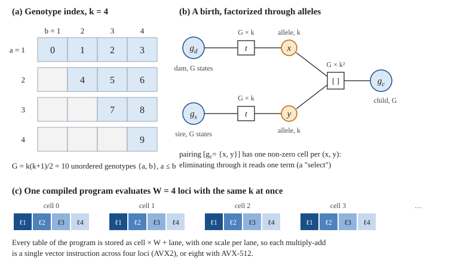
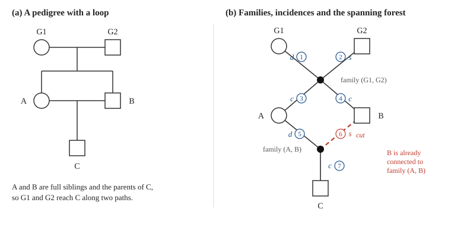
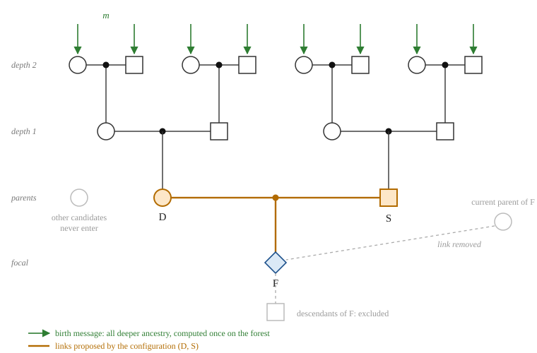
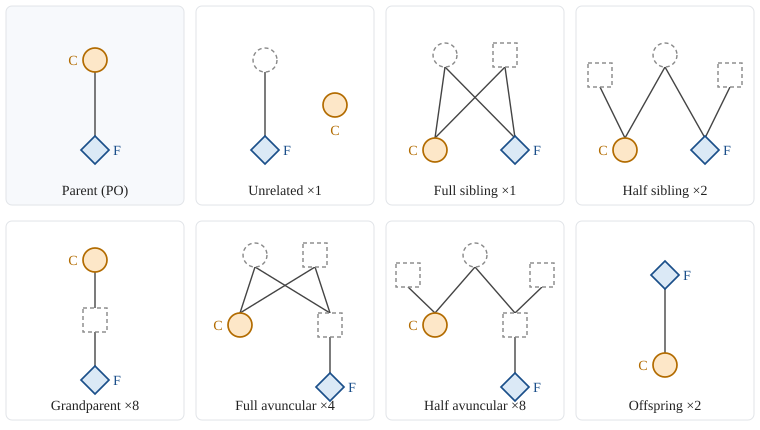

# PaPeR: exact local pedigree likelihoods for parentage assignment with microhaplotypes

<p class="byline">Tyler Wittman</p>
<p class="affil">Technical report · PaPeR version 0.1.0 · November 2026 · <a href="https://github.com/ty-wittman/PaPeR">github.com/ty-wittman/PaPeR</a></p>

> **Abstract.** PaPeR (Parentage and Pedigree Reconstruction) assigns genotyped parents to genotyped individuals from multiallelic microhaplotype or biallelic SNP genotypes, together with each individual's sex and birth year. It follows the heuristic search of Sequoia (Huisman 2017): rounds of greedy assignment, in which every candidate parent must beat the alternative relationships by a likelihood-ratio threshold. It computes each of those decisions differently. A decision is an exact likelihood calculation on a small local pedigree: the focal individual, the candidate parents, their already assigned parents and grandparents, and the unobserved individuals that a rival relationship needs. The calculation runs over all $k(k+1)/2$ genotypes of every $k$-allele locus. Evidence from deeper ancestry enters through sum-product genotype messages, computed on a deterministic spanning forest of the current pedigree. Cutting the pedigree's loops to form that forest is the only approximation outside the local pedigree. Genotyping error is modelled by a dropout/foreign-allele process for microhaplotypes, or by Sequoia's model for SNPs, and the error rate is re-estimated from confident trios with a truncated composite likelihood. This report sets out the model, the graph and message-passing machinery, the decision rules, and the genotype and allele coding that make exact local likelihoods fast enough for thousands of individuals and hundreds of multiallelic loci.

## 1. Introduction

Pedigrees of wild and managed populations underpin estimates of heritability, selection, inbreeding and dispersal (Jones et al. 2010). When behaviour cannot be observed, parentage is inferred from genotypes. Likelihood methods compare the probability of the genotypes under "parent" with their probability under other relationships, and in their simplest form score each candidate against an unrelated individual (Marshall et al. 1998; Kalinowski et al. 2007; Anderson and Garza 2006).

Sequoia (Huisman 2017) extended this to whole multigenerational pedigrees from a few hundred SNPs. It assigns parents greedily in rounds, conditions on the parents assigned so far, tests every candidate against a set of alternative relationships (full and half siblings, grandparents, aunts and uncles), and uses birth years to rule links in or out. Sequoia models biallelic SNPs only. Microhaplotypes are short amplicons containing several SNPs, read as multiallelic haplotypes (Kidd et al. 2014). They are increasingly used in ecology and fisheries because one microhaplotype locus can carry much more information than one SNP, which greatly improves the power of relationship inference (Baetscher et al. 2018).

PaPeR brings Sequoia's approach to multiallelic markers. It keeps Sequoia's search, thresholds and input formats, but builds the likelihood calculations from first principles:

1. **Multiallelic genotypes and error.** Every likelihood runs over all $G=k(k+1)/2$ genotypes of a $k$-allele locus. A dropout/foreign error model captures the dominant error processes of amplicon sequencing (Section 2).
2. **Exact local likelihoods.** Each decision is an exact likelihood calculation, by variable elimination, on a local pedigree that contains the candidates' assigned parents and grandparents. Each rival relationship is drawn as an explicit pedigree with its own unobserved individuals (Section 5).
3. **Messages for deeper ancestry.** Information from more distant relatives enters through sum-product genotype messages on a spanning forest of the current pedigree (Sections 3 and 4). This is the classical peeling computation (Elston and Stewart 1971; Cannings et al. 1978), organized so that each local question can reuse it.
4. **Calibrated error rates.** The error rate is re-estimated from confident trios, and the search restarts when the data rule out the assumed rate (Section 8).

The current release assigns *genotyped* parents. Full pedigree reconstruction, which also clusters sibships and adds dummy parents for unsampled individuals, as Sequoia does, is in active development and is not described here.

This report concentrates on the computational model: the likelihoods, the graph representation of the pedigree and the approximation made at its loops, the message passing, and the genotype and allele coding that makes exact calculation fast. Validation against simulated truth and against Sequoia is summarized in Section 10 and reported in detail in the package's validation document.

**Notation.** $k$ is the number of alleles and $G=k(k+1)/2$ the number of genotypes at a locus; $L$ is the number of loci and $N$ the number of genotyped individuals. Genotypes are $g=\lbrace a,b\rbrace$. The emission $e_i(g)$ is the probability of individual $i$'s observed call given true genotype $g$, and $\pi(g)$ is the Hardy–Weinberg founder prior. Logarithms are natural; PaPeR's public thresholds and LLRs are base 10, so a public threshold $T$ corresponds to $\tau=T\ln 10$ internally. Appendix A lists all symbols.

## 2. Genotypes, errors and inheritance at one locus

### 2.1 Alleles, genotypes and their index

Locus $\ell$ has $k_\ell$ alleles, numbered $1,\dots,k_\ell$; a SNP is the case $k_\ell=2$. A true genotype is an unordered pair $g=\lbrace a,b\rbrace$ with $a\le b$, so a locus has

$$
G_\ell=\frac{k_\ell(k_\ell+1)}{2} \tag{1}
$$

genotypes: 3 for a SNP, 36 for an eight-allele microhaplotype and 105 for a fourteen-allele one. Every genotype-valued quantity in PaPeR (prior, emission, message, factor) is a vector or table over this domain, indexed in row-major upper-triangle order $(1,1),(1,2),\dots,(1,k),(2,2),\dots,(k,k)$ (Figure 1a):

$$
\iota(a,b)=(a-1)\,k-\frac{(a-1)(a-2)}{2}+(b-a),\qquad 1\le a\le b\le k. \tag{2}
$$

A $k\times k$ lookup table maps an ordered pair of alleles to $\iota(\min,\max)$; it is the inner-loop operation that turns two transmitted alleles into a child genotype (Section 6).

Genotype calls are supplied as strings `"a/b"`, with `"0"` for a missing call, and are parsed once into a pair of integer columns per locus. The number of alleles at a locus is taken to be the largest allele number observed. Allele labels therefore have to be renumbered $1,\dots,k$ first, because a locus whose labels run up to 214 would be treated as having 214 alleles and $23{,}005$ genotypes.

**Allele frequencies.** Frequencies are estimated by counting alleles in all called genotypes. An allele declared but never observed receives a pseudocount of one half, so that no allele has probability zero:

$$
p_a=\frac{n_a+\tfrac12[n_a=0]}{2n_{\text{typed}}+\tfrac12 n_{\text{zero}}}, \tag{3}
$$

where $n_a$ counts copies of allele $a$, $n_{\text{typed}}$ is the number of individuals called at the locus and $n_{\text{zero}}$ is the number of unobserved alleles.

**Founders.** An individual with no assigned parent receives the Hardy–Weinberg prior $\pi(\lbrace a,a\rbrace)=p_a^2$, $\pi(\lbrace a,b\rbrace)=2p_ap_b$.

**Loci are independent.** PaPeR assumes no linkage and no linkage disequilibrium between loci. Every likelihood in this report is therefore a product over loci, and every log-likelihood is a sum of per-locus terms. All the machinery below describes one locus.

<figure>

<figcaption><strong>Figure 1.</strong> Genotype and allele coding. <strong>(a)</strong> The <i>G</i> = <i>k</i>(<i>k</i>+1)/2 unordered genotypes of a <i>k</i>-allele locus are indexed along the upper triangle, equation (2). <strong>(b)</strong> A birth is factorized through two gamete variables with <i>k</i> states, two <i>G</i>×<i>k</i> gamete tables <i>t</i> and one pairing indicator, so the <i>G</i><sup>3</sup> table <i>T</i>(<i>g</i><sub>c</sub> | <i>g</i><sub>d</sub>, <i>g</i><sub>s</sub>) is never formed. <strong>(c)</strong> Loci with the same number of alleles share one compiled program and are evaluated four (or eight) at a time, one locus per SIMD lane (Section 6.4).</figcaption>
</figure>

### 2.2 Observation models

The *emission* $e_i(g)=P(\text{call of } i\mid \text{true genotype } g)$ links an individual's observed call to its unobserved true genotype. A missing call has $e_i(g)=1$ for every $g$, which makes it neutral in every calculation. Error rates are single positive numbers for the whole panel; zero and per-locus rates are not allowed.

**Sequoia's SNP model.** For SNP panels, PaPeR offers the error model of Sequoia (Huisman 2017), generalized to $k$ alleles. With panel error rate $E$, the correct call has probability $1-E$, and each wrong call $o\ne g$ receives probability $E\,w(o,g)/Z(g)$, with weight

$$
w(o,g)=\begin{cases}
w_{\text{Far}}=(E/2)^2 & \text{if } o \text{ shares no allele with } g,\\[2pt]
w_{\text{Hom}}=E/2 & \text{if } o \text{ is a homozygote sharing an allele with } g,\\[2pt]
w_{\text{Het}}=E-(E/2)^2 & \text{if } o \text{ is a heterozygote sharing an allele with } g.
\end{cases} \tag{4}
$$

Counting the wrong calls of each kind gives the normalizers

$$
Z(\lbrace a,a\rbrace)=(k-1)\,w_{\text{Het}}+\tfrac{k(k-1)}{2}\,w_{\text{Far}},\qquad
Z(\lbrace a,b\rbrace)=2w_{\text{Hom}}+2(k-2)\,w_{\text{Het}}+\tfrac{(k-1)(k-2)}{2}\,w_{\text{Far}},
$$

which both reduce to $Z=E$ when $k=2$.

**The dropout/foreign model for microhaplotypes.** Errors in amplicon-sequenced microhaplotypes come mostly from two processes. One allele of a heterozygote can fail to amplify or be under-sampled in the reads, so the call is a false homozygote. Less often, a read error or contamination produces an allele that is not there. PaPeR models these as two mechanisms acting in order, in the spirit of the allelic-dropout and false-allele models used for microsatellites (Wang 2004; Kalinowski et al. 2007):

1. *Dropout*, with probability $D$: a true heterozygote $\lbrace a,b\rbrace$ is read as $\lbrace a,a\rbrace$ or $\lbrace b,b\rbrace$, each with probability $D/2$. Homozygotes are unaffected.
2. *Foreign alleles*, with probability $F$ per copy: each of the two surviving copies is independently replaced by a draw from a foreign distribution $q$, which by default is the population frequency vector $p$ (so a foreign draw can reproduce the original allele). $F$ should be a small positive number, such as $5\times10^{-4}$.

With the per-copy kernel $r(x\to u)=(1-F)[u=x]+F\,q_u$, two precursor copies $\lbrace x,y\rbrace$ produce the unordered call $\lbrace u,v\rbrace$ with probability

$$
R(\lbrace x,y\rbrace\to\lbrace u,v\rbrace)=\begin{cases}
r(x\to u)\,r(y\to v)+r(x\to v)\,r(y\to u), & u\ne v,\\
r(x\to u)\,r(y\to u), & u=v,
\end{cases} \tag{5}
$$

and the emissions are

$$
\begin{aligned}
e(o\mid\lbrace a,a\rbrace)&=R(\lbrace a,a\rbrace\to o),\\
e(o\mid\lbrace a,b\rbrace)&=(1-D)\,R(\lbrace a,b\rbrace\to o)+\tfrac D2\,R(\lbrace a,a\rbrace\to o)+\tfrac D2\,R(\lbrace b,b\rbrace\to o).
\end{aligned} \tag{6}
$$

Each emission row sums to one over the $G$ possible calls. The two rates have different signatures in a pedigree, which is what lets PaPeR estimate them separately (Section 8). Dropout creates a false homozygote that still carries one true allele. A foreign allele can create an allele that neither parent carries.

**Closed forms instead of matrices.** PaPeR never stores a $G\times G$ emission matrix. Both models are evaluated in closed form from $(k,p,E)$ or $(k,p,q,D,F)$. The search needs one emission vector per individual and locus, the column of the observed call, which is computed once in $O(G)$ and stored as natural logarithms. The exclusion screens of Section 7 need probabilities such as "a true parent and its offspring share no allele", which sum over all pairs of true and observed genotypes. For these, PaPeR builds $O(k)$ descriptors of each observed call: $d_a=e(o\mid\lbrace a,a\rbrace)$ and $r_a=\sum_b p_b\,e(o\mid\lbrace a,b\rbrace)$. In both error models, an emission depends only on whether the call matches the true genotype, shares one allele with it or shares none, so $r_a$ is a sum over a few classes rather than an $O(k^2)$ loop. The screening probabilities then cost $O(Gk)$ and $O(Gk^2)$ per locus.

### 2.3 Mendelian transmission

A parent with genotype $g=\lbrace a,b\rbrace$ transmits allele $x$ with probability $t(x\mid g)=([x=a]+[x=b])/2$, which is $1$, $\tfrac12$ or $0$. A child of dam genotype $g_d$ and sire genotype $g_s$ has

$$
T(g_c\mid g_d,g_s)=\sum_{x=1}^{k}\sum_{y=1}^{k} t(x\mid g_d)\,t(y\mid g_s)\,\big[g_c=\lbrace x,y\rbrace\big]. \tag{7}
$$

When a parent is unknown (not assigned, or not genotyped), it transmits from the population, $t(x)=p_x$.

Equation (7) is the form PaPeR computes with. It never builds the $G^3$ table $T(g_c\mid g_d,g_s)$, which for $k=8$ would have $36^3=46{,}656$ cells. A birth is instead represented (Figure 1b) by two *gamete variables* $x$ and $y$ with $k$ states each, two $G\times k$ gamete tables $t(x\mid g_d)$ and $t(y\mid g_s)$, and a $G\times k\times k$ *pairing* indicator $[g_c=\lbrace x,y\rbrace]$. The indicator has exactly one non-zero cell in each $(x,y)$ column, so summing over $g_c$ or over one gamete variable reads a single term instead of looping over a domain (Section 6.1). A further saving comes from the fact that every genotype transmits at most two distinct alleles. Each row of the gamete table is therefore stored as two (allele, weight) pairs, which is used when messages are pushed from parents to children (Section 4).

## 3. The pedigree as a graph

### 3.1 State

The only pedigree state is one dam slot and one sire slot for each genotyped individual, each holding a genotyped individual or nothing. A valid state is a directed acyclic graph. No individual is its own parent. A child's dam and sire differ. No individual is used as a dam for one child and a sire for another. Known sexes are respected, and every link is feasible given birth years (Section 7.3). PaPeR never creates individuals: unsampled parents, which Sequoia represents by dummy individuals, are simply empty slots.

### 3.2 Families and incidences

For likelihood calculations the pedigree is represented as a bipartite graph with two kinds of node: individuals and *families*. A family is a (dam, sire) pair, either of which may be unknown, together with all the children assigned to that pair. Each family is connected to its members by *incidences*, labelled dam, sire or child (Figure 2). This is the classical representation of a pedigree as a graph of individuals and matings (Lange and Elston 1975; Cannings et al. 1978). A sibship is one family node, so siblings do not form a loop, and repeated matings of the same pair are the same family. In this graph a cycle is exactly a *pedigree loop*: two individuals joined by two distinct paths of descent or mating. Inbreeding (a mating between relatives) and a parent mated to two relatives are the common sources of loops in wild pedigrees.

### 3.3 A deterministic spanning forest

Sum-product messages (Section 4) are exact on graphs without cycles. PaPeR therefore computes its messages on a spanning forest of the incidence graph, built greedily with union–find (Tarjan 1975):

```
number the families in order of their first child (children in input order)
for each family f, in that order:
    for each incidence of f, in the order dam, sire, children (by input order):
        if the individual and f are already connected:
            mark the incidence as CUT        (it would close a loop)
        else:
            admit it and merge the two components
```

The admitted incidences form a spanning forest. The number of cuts equals the number of independent loops of the pedigree: $I-(N+F-C)$ for $I$ incidences, $N$ individuals, $F$ families and $C$ connected components. Within each loop, the incidence processed last is the one that is cut. The forest depends only on the current pedigree and the input order of the individuals, never on the search history, so the same pedigree always yields the same messages.

### 3.4 What a cut changes

A cut changes the model only for messages, and in one of two ways (Figure 2):

- **A cut parent incidence.** The family treats that parent as unknown. Its children receive the parent's gametes from the population, $\sum_h\pi(h)\,t(a\mid h)=p_a$, instead of from the parent's actual genotype.
- **A cut child incidence.** The child is treated as a founder, with the Hardy–Weinberg prior in place of its birth from its parents. It keeps its own observations and its descendants.

Either way, the two sides of the cut become independent for message purposes, and the evidence that would have crossed it is lost. This is more than dropping a correlation: the far side's genotype information does not reach the near side at all. On a pedigree without loops there are no cuts, and the messages are exact. This was checked numerically against brute-force genotype enumeration. With loops, the messages are approximate, with errors that can go in either direction.

Two features limit the effect of cuts on decisions. First, loops that pass through the individuals of a local question are contracted exactly inside the question (Section 5.2), so the approximation only concerns correlations carried by loops outside it. Second, in the default *ancestral* mode only messages that flow down from ancestors are used (Section 4.1), so a cut matters only if it lies in the ancestry of an individual in the question. There is one inefficiency. Cuts are chosen on the whole graph, so a loop that closes only through descendants (for example, a sire with two dams that are themselves sisters) can still cut an incidence that an ancestral message would use.

### 3.5 Relation to exact and iterative methods

Exact likelihoods on looped pedigrees are possible. A loop can be broken by duplicating an individual and conditioning on the shared genotype (Lange and Elston 1975; Cannings et al. 1978), which is cutset conditioning in the language of graphical models (Pearl 1988). Alternatively the junction-tree algorithm propagates over cliques of a triangulated graph (Lauritzen and Spiegelhalter 1988). Both cost a factor of about $G$ per conditioned genotype or per extra clique dimension, compounded over loops, which is affordable for a few loops but not for whole wild pedigrees under repeated re-evaluation. At the other extreme, iterative peeling in animal breeding (van Arendonk et al. 1989; Kerr and Kinghorn 1996) and loopy belief propagation (Murphy et al. 1999) pass messages around loops until they converge. That gives approximate answers whose quality and convergence depend on the pedigree and on the update schedule.

PaPeR takes a third route. Each message is computed once, on a fixed spanning forest. The messages are exact wherever there is no loop, deterministic, and cheap to maintain under small changes (Section 4.3). Exact computation is kept for the part of the pedigree that matters most for a decision: the small local question.

<figure>

<figcaption><strong>Figure 2.</strong> <strong>(a)</strong> A pedigree with a loop: full siblings A and B are the parents of C (squares are males, circles females). <strong>(b)</strong> The same pedigree as a bipartite graph of individuals and families (black dots), with incidences labelled d (dam), s (sire) and c (child). Numbers give the order in which incidences are processed. Family (G1, G2) is processed first and all four of its incidences are admitted. In family (A, B), A is admitted, but B is already connected to that family through G1 and G2, so B's sire incidence is cut (dashed). For messages, family (A, B) then treats its sire as unknown, and C's paternal gamete comes from the population frequencies. A local question that contains A, B and C still contracts the loop exactly.</figcaption>
</figure>

## 4. Genotype messages

### 4.1 Ancestral messages

By default PaPeR uses *ancestral* evidence: a decision about an individual's parents may use observations of the candidates and of their ancestors, but not of anyone's descendants. Information therefore only flows down the forest, and two kinds of message are needed per locus. For an individual $v$ whose birth incidence is admitted in family $f(v)$, the *ancestor message* is

$$
\mu_v(g)=e_v(g)\times\begin{cases}\pi(g) & \text{if } v \text{ is a founder or its birth incidence is cut,}\\ m_{f(v)\to v}(g) & \text{otherwise,}\end{cases} \tag{8}
$$

and the *birth message* of family $f$ with dam $d$ and sire $s$ is

$$
\begin{aligned}
m_{f\to c}(g)&=\sum_{x,y}\ \gamma_d(x)\,\gamma_s(y)\,\big[g=\lbrace x,y\rbrace\big],\\
\gamma_u(x)&=\begin{cases}\sum_h \mu_u(h)\,t(x\mid h) & \text{if } u \text{ is admitted in } f,\\ p_x & \text{if } u \text{ is unknown or its incidence is cut.}\end{cases}
\end{aligned} \tag{9}
$$

The birth message is the same for every child of the family, so it is computed once per family. On a loop-free pedigree, $\mu_v(g)$ is the joint probability that $v$ has genotype $g$ and that $v$ and all its ancestors have the observed calls; $\gamma_u(x)$ is the corresponding probability that $u$ transmits allele $x$. This is the "anterior" half of classical peeling (Elston and Stewart 1971; Cannings et al. 1978), or the downward pass of the sum-product algorithm on the forest's factor graph (Kschischang et al. 2001). We checked that it matches exact ancestor-closure marginals to relative error $10^{-15}$ on loop-free pedigrees.

### 4.2 Full evidence (experimental)

With `evidence = "full"`, PaPeR runs the complete two-pass sum-product algorithm on the forest. Individual-to-family messages multiply an individual's emission, its prior if it is a founder, and the messages from all its other families:

$$
\nu_{v\to f}(g)=e_v(g)\,[\pi(g)]_{\text{founder}}\prod_{f'\ni v,\ f'\ne f} m_{f'\to v}(g), \tag{10}
$$

and family-to-individual messages sum the family's transmission factors against the incoming messages of its other members:

$$
m_{f\to v}(g_v)=\sum_{\text{other members}}\ \prod_{c\in\text{children}(f)} T(g_c\mid g_d,g_s)\prod_{u\in f,\ u\ne v}\nu_{u\to f}(g_u). \tag{11}
$$

The product of messages at a root gives the likelihood of the whole forest. Full evidence lets descendants inform a decision about their ancestors. It is experimental; blind tests that compared the two modes led to ancestral evidence as the default.

### 4.3 Storage, laziness and updates

Messages are stored per locus as *scaled* vectors over the $G$ genotypes (Section 6.5). In ancestral mode there is one ancestor message per individual and one birth message per family, so storage is $(N+F)\,G$ numbers per locus. Messages are computed lazily, on first use, by an explicit-stack recursion up the forest. Each carries a revision stamp.

After an accepted move, nothing is recomputed eagerly. At the next visit, the forest is rebuilt from the new parent slots, which takes $O(N+F)$, and messages are invalidated selectively:

- If the set of cuts is unchanged, only the moved child and its descendants are marked stale, because ancestral information only flows down.
- If the set of cuts changed, every message is marked stale.

Stale messages are then recomputed on demand, locus by locus. With sparse two-allele gamete rows (Section 6.2), an ancestor message costs $O(G)$ and a birth message $O(G^2)$, so refreshing all messages costs $O(NG+FG^2)$ per locus. A typical move refreshes only a small fraction of that. The warm, incrementally updated forest has been checked to be identical in structure to one built from scratch, over thousands of random sequences of moves.

## 5. Local likelihood questions

Every decision about a focal individual $f$ compares the likelihoods of a few small pedigrees, which PaPeR calls *questions*. A *configuration* $c=(d,s)$ proposes a dam $d$ and a sire $s$ for $f$; either may be absent, written $0$. Two kinds of question are asked about a configuration:

- **Identity questions** score how well the configuration explains the focal individual's genotypes, compared with the configuration "no parents" (Section 5.5).
- **Relationship questions** test one proposed parent against every alternative relationship that the same individuals could have (Section 5.3).

### 5.1 What a question contains

A question is built from the current pedigree, with the focal individual's own parent links removed and replaced by the configuration being tested (Figure 3). It contains:

- **Explicit individuals:** the focal individual, the proposed parents, and the proposed parents' assigned parents and grandparents (depth 2). A birth is modelled explicitly when all of the child's known parents are in the question, so the grandparents enter without their own births.
- **Steiner paths:** the forest paths that connect the explicit individuals. When two explicit individuals are related through the forest, the path between them is included, so that loops among them are evaluated exactly.
- **Latent individuals:** unobserved individuals that a hypothesis needs, such as the shared parent of a pair of half siblings (Section 5.3).
- **Factors:** the emission of every explicit individual that is a named individual or one of its ancestors; Hardy–Weinberg priors for founders and latent individuals; the gamete-factorized births (7) among explicit individuals; and *boundary messages*. These are the birth message (9) of every explicit individual whose family lies outside the question, and the ancestor message (8) of every parent outside the question whose family lies inside it.

Everything else is left out: the descendants of every named individual (in ancestral mode), mates and collateral relatives not on an ancestral line or Steiner path, the focal individual's current parents, and every other candidate. Because other candidates never enter a question, adding an unrelated candidate cannot change the score of an existing configuration. Each individual's observations enter a question exactly once: directly through its emission if it is explicit, or inside exactly one boundary message if it is not.

<figure>

<figcaption><strong>Figure 3.</strong> A local question for focal individual F and configuration (D, S). The explicit individuals are F, the proposed parents D and S, and their assigned parents and grandparents (solid outlines). Their emissions <i>e</i> are factors of the question. Ancestry beyond depth 2 enters through birth messages <i>m</i> (arrows), which summarize all the observed ancestors above each grandparent. F's current parent links are removed (the cavity), and descendants and other candidates are excluded. An unknown parent of an explicit individual transmits population gametes.</figcaption>
</figure>

### 5.2 Exact contraction by variable elimination

A question defines a factor graph over the genotype variables of its individuals (with $G$ states each) and the gamete variables of its births ($k$ states each). Its likelihood

$$
Z=\sum_{\text{all variables}}\ \prod_{\text{factors}}\phi \tag{12}
$$

is computed exactly, per locus, by variable elimination (Zhang and Poole 1994; Dechter 1999; Koller and Friedman 2009). This is the same approach that Superlink applies to linkage likelihoods on general pedigrees (Fishelson and Geiger 2002). The elimination order is chosen per question shape and allele count, by simulating three greedy rules and keeping the cheapest:

1. **Minimum size:** eliminate the variable whose resulting table is smallest.
2. **Weighted minimum fill:** eliminate the variable that adds the fewest new dependencies, weighted by domain sizes.
3. **Minimum work:** eliminate the variable whose step is cheapest, counting a pairing-select step at its reduced cost (Section 6.1).

Before ordering, *barren* variables are pruned: unobserved individuals with no evidence below them sum to one and are removed recursively, together with their transmission factors (Koller and Friedman 2009). The normalizing constants they would contribute are recorded and added back, so pruning never changes a likelihood.

Loops inside a question, such as two proposed parents that are siblings, are ordinary undirected cycles in the factor graph and are contracted exactly. Only *directed* inheritance cycles are impossible, and a hypothesis that would create one is rejected as inapplicable.

One subtlety concerns births that the forest has cut (Section 3.4). Relationship questions keep such births explicit and exact, because sibling and avuncular hypotheses depend on them. Identity questions read every current birth, cut or not, from the stored messages, so that all configurations of a visit see the same cuts. Near a cut loop, identity scores therefore share the forest approximation, while relationship tests do not.

Three outcomes are distinguished, and never confused:

- **Positive likelihood:** the usual case.
- **Structural zero** ($\ln Z=-\infty$): the configuration is impossible under the model. Because error rates are strictly positive, every observed call has positive probability, so in practice structural zeros arise inside intermediate tables (impossible transmissions) rather than as whole-question results; they are kept exact all the same.
- **Unavailable:** the question exceeds its memory or work budget (Section 6.6). An unavailable comparison never rejects anything by itself, but it never authorizes a new assignment either.

### 5.3 Rival relationships as explicit pedigrees

The relationship test asks whether a candidate is really a parent of the focal individual, or some other relative that would explain the same genetic similarity. Each alternative is written as its own small pedigree, with latent individuals where the relationship needs an unobserved ancestor, and scored on exactly the same observed individuals as the parent hypothesis (Figure 4). The default suite, S7, has the parent hypothesis plus seven kinds of rival, which come to 26 oriented pedigrees:

| Rival | Pedigrees | Structure |
|-------------|-----|--------------------------------------|
| Unrelated (U) | 1 | The focal individual's tested parent slot holds a latent founder. |
| Full sibling (FS) | 1 | Focal individual and candidate share both parents. |
| Half sibling (HS) | 2 | They share the dam, or share the sire, with distinct other parents. |
| Grandparent (GP) | 8 | The candidate is a grandparent of the focal individual, or the reverse, through either parent slot of the intermediate individual. |
| Full avuncular (FA) | 4 | The candidate is a full sibling of one of the focal individual's parents, or the reverse. |
| Half avuncular (HA) | 8 | The same with one shared grandparent. |
| Offspring (reverse PO) | 2 | The focal individual is the candidate's parent. |

Rivals are built by a small rule set that creates latent founders for empty parent slots, merges slots that a relationship shares, and forbids coincidences that would change the relationship. A rival whose latent individuals could not exist is *inapplicable* and does not compete. That covers rivals with impossible ages (solved by Bellman–Ford on the difference constraints of Section 7.3), contradictory sexes, or directed cycles. Latent founders that only transmit one gamete are replaced by population gametes before compilation. Two experimental suites, S37 and S45, add compound relationships such as "half sibling and parent", for inbred pedigrees.

The comparison takes the *maximum* over rivals rather than a weighted mixture, so no prior over relationships is needed. For a configuration whose tested side is $u$ (dam or sire),

$$
\Lambda_u=\ln Z_{\text{PO}}-\max_{r\in\text{rivals}}\ln Z_r, \tag{13}
$$

summed over loci within each hypothesis before the maximum is taken.

<figure>

<figcaption><strong>Figure 4.</strong> The parent hypothesis (PO) and the seven kinds of rival in the default S7 suite, drawn for a focal individual F and a candidate dam C. Dashed outlines are latent (unobserved) individuals created by the hypothesis. Each panel shows one orientation; the grandparent, avuncular and half-sibling rivals also have mirrored and reversed forms, 26 pedigrees in all. Every hypothesis is scored on the same observed individuals, so the differences in log-likelihood are likelihood ratios.</figcaption>
</figure>

### 5.4 Summing over loci

Loci are independent, so a hypothesis's log-likelihood is the sum of its per-locus values, $\ln Z_m=\sum_\ell \ln Z_{m,\ell}$. A structural zero at any locus makes the total $-\infty$, and an unavailable locus makes it unavailable. Maxima over hypotheses are taken only after each hypothesis has been summed over the whole panel.

### 5.5 Decision scores

**Identity.** The identity score of configuration $c=(d,s)$ compares the focal individual's genotypes under the proposed parents with their probability if the focal individual were unrelated to them:

$$
I(c)=\sum_\ell \ln Z^{(c)}_\ell-\sum_\ell \ln Z^{(0)}_\ell,\qquad I(0,0)=0. \tag{14}
$$

Both questions contain the same evidence: the observations of $f$, of $d$ and $s$, and of their ancestry. They differ only in the links from $f$ to $d$ and $s$. Because $f$ is a leaf in both (its descendants are excluded), the shared evidence cancels, and $I(c)$ is exactly the predictive log-likelihood ratio

$$
I(c)=\ln P(\text{calls of } f\mid E_d,E_s,\ f\leftarrow(d,s))-\ln P(\text{calls of } f\mid E_d,E_s), \tag{15}
$$

where $E_d$ and $E_s$ are the observations of the proposed parents and their ancestors.

**Support.** A newly proposed parent must add evidence beyond the configuration without it. With $\tau=T_{\text{assign}}\ln 10$ ($T_{\text{assign}}=0.5$ by default, as in Sequoia),

$$
\begin{aligned}
S_{\text{dam}}&=I(d,s)-I(0,s), \qquad S_{\text{sire}}=I(d,s)-I(d,0),\\
S_{\text{pair}}&=I(d,s)-\max\lbrace I(0,0),\,I(d,0),\,I(0,s)\rbrace,
\end{aligned} \tag{16}
$$

and each support that applies (a parent not already assigned, and the pair when both are new) must exceed $\tau$.

**Relationship gate.** Each proposed parent must beat its best admitted rival: $\Lambda_u>\tau$ in (13) for each tested side. For a pair, the smaller of the two sides must pass.

**Choice.** Among the configurations that pass every gate, PaPeR picks the one with the largest identity score. It must also beat the next best configuration by a margin, $I(c)-\max_{c'\ne c}I(c')>\text{margin}\cdot\ln 10$, with margin 0.5 by default. Ties within $10^{-6}$ go to the current parents, then to fewer parents, then to input order. A current parent is never removed just because "no parent" scores competitively. It is removed only if it now fails a gate or is replaced by a better-supported configuration.

Supports are computed before the relationship panel. A configuration that fails its support test is never scored against rivals, and that ordering saves most of the cost of the gates.

## 6. Making exact local likelihoods fast

A search scores many candidate configurations for every individual, against several rival relationships each, in every round and on every locus. That makes a very large number of small exact contractions. They are fast enough because of the representations below, almost all of which come from the genotype and allele structure of Section 2.

### 6.1 Factorizing inheritance through alleles

The naive transmission factor $T(g_c\mid g_d,g_s)$ is a three-way table with $G^3$ cells, which is $O(k^6)$. PaPeR's factorization (7) replaces it with two gamete tables of $G\times k$ cells and one pairing indicator of $G\times k^2$ cells. The indicator $[g_c=\lbrace x,y\rbrace]$ has a single non-zero cell in every $(x,y)$ column and a single compatible partner allele for any $(g_c,x)$. When an elimination step involves a pairing indicator, the compiler marks the step as a *select*: instead of summing over the eliminated variable, it reads the one compatible state from the $k\times k$ lookup table $\iota$ or a partner table. The work charged to the step drops from $\text{cells}\times|\text{domain}|\times n_{\text{inputs}}$ to $\text{cells}\times(n_{\text{inputs}}-1)$.

For a trio whose parents carry only unary factors (emissions, priors or incoming messages), summing each parent out of its gamete table costs $O(Gk)$ and leaves a vector over that parent's transmitted allele. The child is then eliminated by select over the $k^2$ gamete pairs. A trio therefore costs $O(Gk+k^2)=O(k^3)$ per locus, instead of the $O(G^3)=O(k^6)$ of the naive table. A birth with one unknown parent uses a single $G\times G$ table, $T(g_c\mid g_x)=\sum_{a,b}t(a\mid g_x)\,p_b\,[g_c=\lbrace a,b\rbrace]$, which folds the population mate in once per locus.

### 6.2 Two-gamete messages

Every genotype transmits at most two alleles, so each row of the gamete table is stored as two (allele, weight) pairs. The family-to-child message of Section 4 and the parent-pair child tables are built from these sparse rows. Filling a $G\times G$ parent-pair table then costs $2G^2$ multiply-adds instead of $kG^2$, and the family-to-child message costs $O(G^2)$ instead of $O(G^2k)$.

### 6.3 Compiled programs, shared by shape and allele count

A local question (Section 5) is first built as a locus-independent *plan*: its variables, factor scopes and the messages it reads. The plan is compiled separately for each allele count $k$ present in the panel into a *program*: a fixed sequence of variable-elimination steps with precomputed strides, offsets and workspace layout. Evaluating a locus then only runs arithmetic. Compiled programs are kept in a per-thread registry keyed by the plan's shape (variables, domains, scopes and $(G,k)$), with a least-recently-used byte budget. The same program serves every locus with that allele count and every later question of the same shape, including across the restarts of error calibration.

Questions are also deduplicated before evaluation. Each plan receives a canonical key computed by colour refinement, which does not depend on how variables are numbered or which parent is listed first. Questions with isomorphic plans share one likelihood entry, so a candidate whose question has the same structure and the same data as one already evaluated costs only a lookup.

### 6.4 Loci as SIMD lanes

Loci are independent and share one program when they have the same allele count. PaPeR therefore vectorizes *across loci* rather than within tables. Loci are grouped by $(G,k)$ and cut into batches of $W=4$ lanes, or $W=8$ when the processor supports AVX-512. Every table of a program is stored interleaved, `cell * W + lane`, with a separate scale for each lane (Figure 1c), so a single instruction stream evaluates the program on $W$ loci at once using GCC vector types. On Linux with GCC, the 4-lane kernel is compiled twice, for AVX2 and for a portable baseline, and the right version is chosen when the library loads (`target_clones`). The 8-lane kernel is used only when the processor reports AVX-512 support. Short batches are padded by repeating a locus. A lane group falls back to the scalar path for the rare cases the vector kernel does not handle, such as a structural zero or a value outside the double range. The scalar kernel unrolls the common step arities (one to ten input tables) and keeps two partial sums to shorten dependency chains.

Lane batching is not the same as multithreading. The engine contains a locus worker pool, but the public interface runs one worker, so one PaPeR call uses one CPU core.

### 6.5 Numerics: scaled linear arithmetic with a log fallback

Everything stored (priors, emissions, transmission, messages) is a natural logarithm, but contractions run in linear arithmetic. Linear sums of products are much cheaper than log-sum-exp. Each table or message is held as a *scaled* vector: cells normalized to a unit maximum, plus a log scale. A table is rescaled only when its maximum leaves $[10^{-30},10^{30}]$, so a product of up to ten tables stays in range without per-step normalization. Three safeguards keep this exact:

- If a product of two positive cells would underflow below the smallest normal double, the whole program is re-run on a *log route* that performs the same steps with `log_add` ($\max+\operatorname{log1p}(e^{\min-\max})$).
- A message whose dynamic range exceeds double precision is stored as logarithms rather than scaled linear values.
- A table whose cells are all zero receives scale $-\infty$. This is a *structural zero*: an impossible configuration, kept as $-\infty$ in log space and never confused with "no information".

### 6.6 Bounded work and memory

Every program is checked against a memory and work budget before it runs: by default 64 MiB for any intermediate table and for the cumulative workspace, and $4\times10^8$ multiply-adds per single-locus evaluation. A question that exceeds either budget is reported as *unavailable* and treated as missing evidence, never as zero likelihood (Section 5.2). The budgets are generous. A table with three genotype axes reaches 64 MiB only at $G\approx 203$ ($k\approx 19$ alleles), far above the 3–8 alleles per locus of the example data.

### 6.7 Reuse across candidates, visits and rounds

| Lifetime | What is reused |
|--------|------------------------------|
| One call | per-locus tables (priors, gamete tables, lookup and partner tables), the interleaved lane tables, and the batch layout |
| Across questions | compiled programs, keyed by plan shape and allele count |
| One visit | results of isomorphic questions; parent-pair child tables and forest-only sub-plans shared by the rival hypotheses of the visit; the partitions of the last shared boundary |
| Across visits | forest messages, which persist until an accepted move makes them stale (Section 4.3) |
| Structural | topology templates for rival relationships and life-history feasibility results |

The overall effect is that adding a candidate to a visit usually costs a handful of small per-locus programs that have already been compiled, run on four or eight loci per instruction stream, and reuse messages that are already up to date.

### 6.8 Cost summary

| Operation | Cost per locus |
|------------------------|--------------------|
| Emission vector of one individual | $O(G)$ |
| Exclusion-screen probabilities (Section 7) | $O(Gk)$ to $O(Gk^2)$ |
| Family-to-child message | $O(G^2)$ |
| Trio contraction | $O(Gk+k^2)$ |
| Elimination step | $O(\text{cells}\times\text{domain}\times\text{inputs})$, or $O(\text{cells}\times\text{inputs})$ with select |
| One question, over all loci | about $L/W$ program runs per distinct $(G,k)$ |

Two classical speed-ups are not used. Genotype elimination (Lange and Goradia 1987) would shrink the genotype domains of individuals whose relatives' calls rule some genotypes out; PaPeR instead carries impossible states as structural zeros. Missing loci are not skipped: a missing call has an all-ones emission and goes through the same program, so the cost of a question does not depend on missingness. Both remain possible future optimizations.

## 7. Candidates, ages and the search

The exact local likelihoods of Section 5 are too costly to compute for every pair of individuals. As in Sequoia, a cheap screen first reduces each individual's possible parents to a short list. Hard life-history constraints remove impossible links, and a greedy search then assigns parents in rounds.

### 7.1 Exclusion screens with calibrated ceilings

**Opposite homozygotes.** For a true parent and offspring, the two genotypes share an allele at every locus unless a genotyping error intervenes. PaPeR counts the loci at which a candidate pair is *allele-disjoint*: both called, with no allele in common. For SNPs this is exactly Sequoia's opposite-homozygote count, because a heterozygote shares an allele with every SNP genotype. For multiallelic loci it is the natural generalization. A trio is screened in the same way by its Mendelian errors: loci at which the offspring's call cannot be formed from one allele of each parent's call.

**Per-locus probabilities under the truth.** For each locus PaPeR computes the probability $p^{\text{OH}}_\ell$ that a *true* parent–offspring pair is allele-disjoint, and the probability $p^{\text{ME}}_\ell$ that a *true* trio shows a Mendelian error, under the error model and allele frequencies. For a pair, let $a\sim p$ be the shared transmitted allele, let each individual's other allele be an independent draw from $p$, and let $r_o(a)=\sum_b p_b\,e(o\mid\lbrace a,b\rbrace)$ be the probability that a carrier of $a$ is called $o$ (Section 2.2). Then

$$
p^{\text{OH}}=\sum_a p_a\sum_o r_o(a)\sum_{o'\,:\,o'\cap o=\varnothing} r_{o'}(a), \tag{17}
$$

where the inner sum is computed by inclusion–exclusion over the alleles of $o$. The trio probability is built the same way from the two transmitted alleles. These formulas were checked against brute-force enumeration over all true and observed genotypes.

**Ceilings.** Loci are independent, so a true pair's count $S=\sum_\ell B_\ell$ with $B_\ell\sim\text{Bernoulli}(p_\ell)$ has a Poisson-binomial distribution. Its exact distribution is obtained by convolution, and the ceiling is the smallest count that retains a true parent with probability $\rho$:

$$
T=\min\lbrace t:\Pr(S\le t)\ge\rho\rbrace,\qquad \rho=0.9999^{1/N}, \tag{18}
$$

where $N$ is the number of genotyped individuals. Over the $N$ individuals of a data set, a true parent is then screened out with probability of order $10^{-4}$. The same rule gives the opposite-homozygote ceiling `T` and the trio ceiling `MaxMendelE`. With 100 microhaplotypes and 595 individuals ($\rho=0.9999998$) the example data give $T=6$ and $\text{MaxMendelE}=8$, against expected counts of 0.25 and 0.61 for a true parent. The ceilings are computed as if every locus were called, which is conservative, because missing calls can only lower a count.

### 7.2 Short lists

Every pair that passes the age and opposite-homozygote screens is scored by a pedigree-free pairwise log-likelihood ratio, parent–offspring against unrelated (Section 9.2). A candidate is kept if this ratio is at least $T_{\text{filter}}\ln 10$, where $T_{\text{filter}}=-2$ as in Sequoia. The surviving candidates on each side (dam or sire) are ranked by the same ratio, and the best 50 are kept. This short list is fixed for the whole search, except that a current parent outside it is added back.

At each visit, the single-parent configurations are scored first. The ten best on each side by identity score are retained, along with the incumbents. A two-parent configuration is proposed only if both of its parents are retained and at least one of them is within $\ln 100$ of passing on its own. Proposed pairs must also pass the trio Mendelian-error ceiling and a pedigree-free trio likelihood screen. After a provisional winner is chosen, *pair rescue* adds back any pair that shares a parent with the winner but was left out only because of the top-ten cap. The focal individual is then rescored until no new pair is added.

### 7.3 Life history as constraints

Each genotyped individual has a birth-year interval $[lo_i,hi_i]$: the exact birth year, or `BY.min` to `BY.max`. It may also have a last year in which it could breed, $Y_i$ (`Year.last`). The parent-age limits are $m_s$ (`MinAgeParent`, default 1) and $M_s$ (`MaxAgeParent`, default the span of all birth years), separately for dams and sires. For every assigned link from parent $p$ to child $v$ on side $s$, the unknown birth years $b$ must satisfy the difference constraints

$$
m_s\le b_v-b_p\le M_s,\qquad b_v\le Y_p,\qquad lo_v\le b_v\le hi_v. \tag{19}
$$

PaPeR propagates these constraints through all assigned links, using max-plus relaxation for lower bounds and min-plus relaxation for upper bounds. The stored intervals are therefore the exact feasible ranges given the whole current pedigree. A proposed link is infeasible if it empties an interval or creates a cycle. Only the affected connected component is re-solved for each proposal. The same constraints, solved by Bellman–Ford, decide whether a rival relationship's latent individuals can exist (Section 5.3).

Age is a *hard constraint only*: PaPeR has no age prior, and no age probability enters any likelihood.

### 7.4 The search

```
for round = 1, 2, ..., 41:
    order the genotyped individuals by expected birth year, then by
        generation depth in the current pedigree, then by ID
    for each focal individual f in that order:
        skip f if it already has both parents (ordinary rounds only)
        score all surviving configurations (0,0), (d,0), (0,s), (d,s)
        choose a configuration (Section 5.5); if it differs from f's
            current parents, apply it immediately
    recheck: revisit complete parent pairs whose neighbourhood changed
    stop if no parent changed, no recheck changed anything, and no
        recheck is pending (a fixed point)
    stop if this pedigree state was seen before (a cycle)
```

Accepted moves update the parent slots and the birth-year intervals immediately, and the message forest is brought up to date at the start of the next visit (Section 4.3), so later visits in the same round build on them. A *complete* parent pair is not revisited in ordinary rounds, following Sequoia. It is reopened in a recheck wave when the focal individual, one of its parents or a candidate changes ancestry. The search stops at a fixed point, or reports non-convergence if it revisits an earlier state or reaches 41 rounds. On the example data it converges in two rounds.

## 8. Error-rate calibration

Assumed error rates are often wrong, and a rate that is too low makes true parents look excluded. PaPeR therefore estimates the error rate from the pedigree it has just inferred, and restarts the search if the data clearly show more errors than were assumed.

### 8.1 Confident trios

Only complete trios that the search decided with a wide margin are used. A trio qualifies if its identity margin and its relationship contrasts each clear their thresholds by one extra base-10 unit ($\Delta>(\text{margin}+1)\ln 10$ and $\Lambda>(T_{\text{assign}}+1)\ln 10$), and all three supports exceed $T_{\text{assign}}\ln 10$ (Section 5.5). At least ten confident trios are required for a fit. Every called locus of a confident trio is an observation: consistent, or a Mendelian error. A trio was admitted by the search only if its Mendelian-error count $S_j$ was at most $M=\texttt{MaxMendelE}$. The fit conditions on that admission, so it does not mistake the screen's truncation for a low error rate.

### 8.2 SNPs

For the SNP model, each locus has the true-trio Mendelian-error probability $p_\ell(E)$ of Section 7.1, now as a function of the error rate. For trio $j$ with $c_j$ errors over its called loci, the exact count distribution is Poisson-binomial, truncated to $0,\dots,M$. The calibration log-likelihood is

$$
\ell(E)=\sum_j\Big[\ln P_E(S_j=c_j)-\ln P_E(S_j\le M)\Big], \tag{20}
$$

maximized over $E\in[10^{-12},0.25]$. The 95% interval is the profile-likelihood set $\lbrace E:\ell_{\max}-\ell(E)\le\chi^2_{1,0.95}/2\rbrace$ (Wilks 1938; Pawitan 2001).

### 8.3 Microhaplotypes

For the dropout/foreign model, each called locus of a confident trio falls into one of three categories: consistent, inconsistent with a homozygous offspring call, or inconsistent with a heterozygous one. Their probabilities $q_{\ell,\text{hom}}(D,F)$ and $q_{\ell,\text{het}}(D,F)$ are exact polynomials of degree at most 3 in $D$ and 6 in $F$, because each emission (6) is linear in $D$ and quadratic in $F$, and a trio involves three emissions. PaPeR obtains the exact coefficients for each locus by interpolation on a $4\times7$ grid of $(D,F)$ values, and checks that the two categories add up to the trio error probability. The calibration log-likelihood is

$$
\ell(D,F)=\sum_\ell\sum_{c\in\lbrace 0,\text{hom},\text{het}\rbrace} n_{\ell c}\,\ln q_{\ell c}(D,F)-\sum_j\ln P_{D,F}(S_j\le M), \tag{21}
$$

where $n_{\ell c}$ counts the trio–locus observations in category $c$. Dropout and foreign alleles produce the two kinds of inconsistency in different proportions, so the two categories identify $D$ and $F$ separately. The fit is maximized from three starting points on $[10^{-12},0.25]^2$. Each rate's 95% interval is a profile interval, re-maximizing over the other rate.

Equations (20) and (21) are *composite* likelihoods (Lindsay 1988; Varin et al. 2011). They treat trios as independent, but trios share parents, and they ignore the fact that confident trios were selected using the same data. The intervals are therefore approximate. In blind tests the SNP estimate ran about 10% low.

### 8.4 The guarded policy

```
rates = supplied rates
for pass = 1, ..., 4:
    run a fresh search from the original inputs at these rates
    fit the error rates on the confident trios (needs >= 10)
    raise the SNP rate or Dropout to its lower 95% bound, if that bound is higher
    on pass 1 only: lower a rate to its upper 95% bound if it is more than twice
        that bound and at least 70% of complete trios are confident
    never change Foreign
    stop if no rate changed
```

Raising to the *lower* bound means the rate is changed only when the data rule out the assumed value, and then by the smallest amount consistent with the data. Each restart is a fresh search, not a continuation, so the final pedigree depends only on the final rates. On the example data the supplied dropout rate (0.005) lies inside the fitted interval (0.0046–0.0077), so PaPeR keeps it and runs a single search.

## 9. Final LLRs and pairwise likelihoods

### 9.1 Final LLRs

After the search, PaPeR can report Sequoia-style log-likelihood ratios for every assigned parent. With `CalcLLR = TRUE` they are computed after calibration, at the final error rates. They are computed on a fresh copy of the final pedigree, with all parents fixed, all screens switched off and each focal individual visited once without changing anything. For an assigned dam $d$, with the assigned sire kept,

$$
\text{LLR}_{\text{dam}}=\frac{1}{\ln 10}\Big[\ln Z_{\text{PO}}-\max_{r\in\text{rivals}}\ln Z_r\Big], \tag{22}
$$

which is the relationship contrast (13) in base 10, and $\text{LLR}_{\text{sire}}$ likewise. $\text{LLR}_{\text{pair}}=\min(\text{LLR}_{\text{dam}},\text{LLR}_{\text{sire}})$ is a weakest-side summary when both parents are assigned. It is not a separate test of the pair. The output also counts the allele-disjoint loci between each parent and the offspring ($\text{OH}_{\text{dam}}$, $\text{OH}_{\text{sire}}$) and the trio's Mendelian errors ($\text{ME}_{\text{pair}}$), and gives a status for each value: available, unavailable, or not assigned. The same calculation is available for any user-supplied pedigree through `calc_llr()`.

### 9.2 Pairwise likelihoods from identity states

Several steps need a relationship likelihood for a *pair* of individuals without a pedigree context: the $T_{\text{filter}}$ screen and short-list ranking (Section 7.2), duplicate detection, and the search for likely relatives missing from a pedigree. PaPeR computes these from Jacquard's nine condensed identity-by-descent states (Jacquard 1974), in the likelihood framework of Thompson (1975):

$$
P(o_i,o_j\mid R)=\sum_{s=1}^{9}\Delta_s(R)\,P(o_i,o_j\mid S_s), \tag{23}
$$

where $S_1,\dots,S_9$ are the identity states of the four genes carried by individuals $i$ and $j$, and $\Delta_s(R)$ is the probability of state $s$ under relationship $R$. Each state probability is computed directly on the *observed* calls $o_i$ and $o_j$, folding in the error model, from four $O(k)$ descriptors of each call: $d(a)=e(o\mid\lbrace a,a\rbrace)$, $r(a)=\sum_b p_b\,e(o\mid\lbrace a,b\rbrace)$, $h=\sum_a p_a d(a)$ and $m=\sum_a p_a r(a)$. For the three states that occur without inbreeding,

$$
\begin{aligned}
P(o_i,o_j\mid S_7)&=\textstyle\sum_{a,b}p_ap_b\,e_i(\lbrace a,b\rbrace)\,e_j(\lbrace a,b\rbrace),\\
P(o_i,o_j\mid S_8)&=\textstyle\sum_a p_a\,r_i(a)\,r_j(a),\\
P(o_i,o_j\mid S_9)&=m_i\,m_j,
\end{aligned} \tag{24}
$$

for two shared genes, one and none. The six inbred states are formed from $d$, $h$ and $r$ in the same way. All states except $S_7$ cost $O(k)$, and no $G\times G$ matrix is ever formed. The relationships use the standard coefficients:

| Relationship | $\Delta_7$ | $\Delta_8$ | $\Delta_9$ |
|----------------------|-----|-----|-----|
| Unrelated | 0 | 0 | 1 |
| Parent–offspring | 0 | 1 | 0 |
| Full siblings | 1/4 | 1/2 | 1/4 |
| Half siblings, grandparent, full avuncular | 0 | 1/2 | 1/2 |
| Half avuncular | 0 | 1/4 | 3/4 |
| Same individual (duplicate) | 1 | 0 | 0 |

The table shows why pairwise likelihoods are not enough for parentage in a pedigree: half siblings, grandparents and full aunts or uncles have identical coefficients, so a pair's genotypes cannot tell them apart. Context can. The same pairs become distinguishable once each candidate's assigned parents and grandparents are part of the calculation, which is what the local questions of Section 5 provide. The pairwise likelihoods were checked against the relationship matrices of CKMRsim (Anderson, CKMRsim R package) to within $10^{-12}$.

## 10. Verification and performance

**Exactness checks.** The test suite (about 3,900 expectations) checks the likelihood machinery against independent calculations:

- Final LLRs on small pedigrees are compared with brute-force enumeration over every latent genotype, with the emissions recomputed independently inside the test.
- Pairwise relationship likelihoods are compared with CKMRsim's relationship matrices (Section 9.2), to within $10^{-12}$, when that package is installed.
- A test on a looped pedigree checks that warm (incrementally updated), cold (rebuilt from scratch), unpruned and move-by-move replayed evaluations give the same decisions and values.
- During development, rebuilding all messages and plans from scratch reproduced the incrementally maintained values for 2,674 questions to within $3.6\times10^{-12}$, and pruning barren variables changed 916 questions by at most $1.4\times10^{-12}$ (natural-log units). On loop-free pedigrees, message-based questions matched a reference implementation that wrote out the full ancestry explicitly to within $7\times10^{-15}$. That reference has since been removed from the code.
- For this report, the forest messages were checked again against brute-force enumeration on small loop-free pedigrees (agreement to machine precision), and against small looped pedigrees, where they differ as Section 3.4 describes.

**Accuracy.** On the simulated example data shipped with the package (700 individuals over six birth years, 595 genotyped on 100 microhaplotypes with 3–8 alleles), PaPeR assigns all 387 genotyped dams and 400 genotyped sires, with no wrong assignments. On 150 SNPs of the same individuals it finds 383 dams and 396 sires and makes one wrong assignment. In a 729-condition simulation study (600–2,000 individuals, 100–300 loci, three true and three assumed error rates, and call and individual missingness), PaPeR on microhaplotypes found more parents and made fewer wrong assignments than Sequoia 3.2.0 on SNP panels of the same size in nearly every condition. On the same SNP data, in blind tests run before error calibration was added (and to be repeated), the two programs found about the same number of parents (0.5% fewer for PaPeR) and PaPeR made 22% fewer wrong assignments. The package's validation document gives the full design, results and provenance.

**Speed.** On one core, the 595-individual example with 100 microhaplotypes runs in about a minute, including final LLRs. PaPeR is generally one to five times slower than Sequoia, depending on data size, because each decision is an exact local likelihood.

## 11. Limitations and extensions

- **Forest cuts.** Evidence carried around pedigree loops outside the local question is lost at the cut (Section 3.4). Exact alternatives, such as conditioning on loop-breaker genotypes or junction-tree propagation, cost time exponential in the number of loops cut. Iterating messages to a loopy fixed point would make the result depend on update order.
- **Unlinked loci and panel-wide error rates.** Linkage, linkage disequilibrium and locus-specific error rates are not modelled. Locus-specific rates could be added to the emission tables without changing the rest of the machinery.
- **Foreign alleles are not recalibrated.** Only Dropout (or the SNP rate) is adjusted. A misstated Foreign rate stays wrong.
- **Hard age limits.** Ages only rule links in or out. An age prior could sharpen close calls between relatives of different ages.
- **Genotyped parents only.** The current release does not cluster sibships or add dummy parents for unsampled individuals. Full pedigree reconstruction is in active development. It needs questions whose explicit individuals are themselves unobserved, which the same local-likelihood and message machinery can express.
- **Pairwise utilities.** Duplicate detection and the search for likely relatives score every pair of individuals and are slow on thousands of samples.

## Authorship

PaPeR was written by Tyler Wittman together with AI coding and documentation assistance (Claude by Anthropic, and OpenAI models). The author set the scientific goals, made the modelling, design and scientific decisions, directed and reviewed the work, and designed and performed the validation studies. Much of the code, tests and documentation were written using AI and reviewed by the author. This report was drafted with Claude from the source code and the project's documentation, and its description of the implementation was checked against the code.

## References

Anderson, E. C. CKMRsim: inference of pairwise relationships using likelihood ratios. R package. <https://github.com/eriqande/CKMRsim>

Anderson, E. C., and Garza, J. C. (2006). The power of single-nucleotide polymorphisms for large-scale parentage inference. *Genetics* 172(4), 2567–2582. <https://doi.org/10.1534/genetics.105.048074>

Baetscher, D. S., Clemento, A. J., Ng, T. C., Anderson, E. C., and Garza, J. C. (2018). Microhaplotypes provide increased power from short-read DNA sequences for relationship inference. *Molecular Ecology Resources* 18(2), 296–305. <https://doi.org/10.1111/1755-0998.12737>

Cannings, C., Thompson, E. A., and Skolnick, M. H. (1978). Probability functions on complex pedigrees. *Advances in Applied Probability* 10(1), 26–61. <https://doi.org/10.2307/1426718>

Dechter, R. (1999). Bucket elimination: a unifying framework for reasoning. *Artificial Intelligence* 113(1–2), 41–85.

Elston, R. C., and Stewart, J. (1971). A general model for the genetic analysis of pedigree data. *Human Heredity* 21(6), 523–542.

Fishelson, M., and Geiger, D. (2002). Exact genetic linkage computations for general pedigrees. *Bioinformatics* 18(Suppl. 1), S189–S198. <https://doi.org/10.1093/bioinformatics/18.suppl_1.s189>

Huisman, J. (2017). Pedigree reconstruction from SNP data: parentage assignment, sibship clustering and beyond. *Molecular Ecology Resources* 17(5), 1009–1024. <https://doi.org/10.1111/1755-0998.12665>

Jacquard, A. (1974). *The Genetic Structure of Populations*. Springer, Berlin.

Jones, A. G., Small, C. M., Paczolt, K. A., and Ratterman, N. L. (2010). A practical guide to methods of parentage analysis. *Molecular Ecology Resources* 10(1), 6–30.

Kalinowski, S. T., Taper, M. L., and Marshall, T. C. (2007). Revising how the computer program CERVUS accommodates genotyping error increases success in paternity assignment. *Molecular Ecology* 16(5), 1099–1106.

Kerr, R. J., and Kinghorn, B. P. (1996). An efficient algorithm for segregation analysis in large populations. *Journal of Animal Breeding and Genetics* 113, 457–469. <https://doi.org/10.1111/j.1439-0388.1996.tb00636.x>

Kidd, K. K., Pakstis, A. J., Speed, W. C., Lagacé, R., Chang, J., Wootton, S., Haigh, E., and Kidd, J. R. (2014). Current sequencing technology makes microhaplotypes a powerful new type of genetic marker for forensics. *Forensic Science International: Genetics* 12, 215–224.

Koller, D., and Friedman, N. (2009). *Probabilistic Graphical Models: Principles and Techniques*. MIT Press, Cambridge, MA.

Kschischang, F. R., Frey, B. J., and Loeliger, H.-A. (2001). Factor graphs and the sum-product algorithm. *IEEE Transactions on Information Theory* 47(2), 498–519.

Lange, K., and Elston, R. C. (1975). Extensions to pedigree analysis I. Likelihood calculations for simple and complex pedigrees. *Human Heredity* 25(2), 95–105. <https://doi.org/10.1159/000152714>

Lange, K., and Goradia, T. M. (1987). An algorithm for automatic genotype elimination. *American Journal of Human Genetics* 40(3), 250–256.

Lauritzen, S. L., and Spiegelhalter, D. J. (1988). Local computations with probabilities on graphical structures and their application to expert systems. *Journal of the Royal Statistical Society, Series B* 50(2), 157–224.

Lindsay, B. G. (1988). Composite likelihood methods. *Contemporary Mathematics* 80, 221–239.

Marshall, T. C., Slate, J., Kruuk, L. E. B., and Pemberton, J. M. (1998). Statistical confidence for likelihood-based paternity inference in natural populations. *Molecular Ecology* 7(5), 639–655.

Murphy, K. P., Weiss, Y., and Jordan, M. I. (1999). Loopy belief propagation for approximate inference: an empirical study. In *Proceedings of the 15th Conference on Uncertainty in Artificial Intelligence*, 467–475.

Pawitan, Y. (2001). *In All Likelihood: Statistical Modelling and Inference Using Likelihood*. Oxford University Press, Oxford.

Pearl, J. (1988). *Probabilistic Reasoning in Intelligent Systems: Networks of Plausible Inference*. Morgan Kaufmann, San Mateo, CA.

Tarjan, R. E. (1975). Efficiency of a good but not linear set union algorithm. *Journal of the ACM* 22(2), 215–225.

Thompson, E. A. (1975). The estimation of pairwise relationships. *Annals of Human Genetics* 39(2), 173–188. <https://doi.org/10.1111/j.1469-1809.1975.tb00120.x>

van Arendonk, J. A. M., Smith, C., and Kennedy, B. W. (1989). Method to estimate genotype probabilities at individual loci in farm livestock. *Theoretical and Applied Genetics* 78(5), 735–740. <https://doi.org/10.1007/BF00262571>

Varin, C., Reid, N., and Firth, D. (2011). An overview of composite likelihood methods. *Statistica Sinica* 21(1), 5–42.

Wang, J. (2004). Sibship reconstruction from genetic data with typing errors. *Genetics* 166(4), 1963–1979. <https://doi.org/10.1534/genetics.166.4.1963>

Wilks, S. S. (1938). The large-sample distribution of the likelihood ratio for testing composite hypotheses. *Annals of Mathematical Statistics* 9(1), 60–62.

Zhang, N. L., and Poole, D. (1994). A simple approach to Bayesian network computations. In *Proceedings of the Tenth Canadian Conference on Artificial Intelligence*, 171–178.

## Appendix A. Notation

| Symbol | Meaning |
|----------|------------------------|
| $k$, $G=k(k+1)/2$ | alleles and unordered genotypes at a locus |
| $L$, $N$, $F$ | loci, genotyped individuals, families |
| $g=\lbrace a,b\rbrace$, $\iota(a,b)$ | a genotype and its index, equation (2) |
| $p_a$, $q$ | allele frequencies; foreign-allele distribution (default $q=p$) |
| $\pi(g)$ | Hardy–Weinberg founder prior |
| $e_i(g)$ | emission: probability of $i$'s call given true genotype $g$ |
| $E$; $D$, $F$ | SNP error rate; dropout and foreign-allele rates |
| $t(x\mid g)$, $T(g_c\mid g_d,g_s)$ | transmission of allele $x$; child given parents, equation (7) |
| $\mu_v$, $m_{f\to c}$, $\gamma_u$ | ancestor message, birth message, transmitted-allele message, equations (8) and (9) |
| $f$, $c=(d,s)$ | focal individual and a configuration of proposed parents |
| $Z$, $\ln Z_m$ | likelihood of a question; summed over loci for hypothesis $m$ |
| $I(c)$, $S$, $\Lambda$ | identity score, supports and relationship contrast, equations (13) to (16) |
| $\tau=T_{\text{assign}}\ln 10$ | the assignment threshold in natural-log units |
| $T$, $M$ | opposite-homozygote and Mendelian-error ceilings, equation (18) |
| $\Delta_s(R)$ | Jacquard identity-state coefficients of relationship $R$ |

## Appendix B. Where things are in the code

| Topic | Source files |
|------------|--------------------|
| Genotype parsing, allele frequencies | `R/genotypes.R`, `R/stats.R` |
| Error models, compact emissions, screening probabilities | `R/errors.R`, `R/tables.R`, `src/compact_likelihood.h`, `src/likelihood_core.cpp` |
| Pedigree state and graph | `R/pedigree_state.R`, `src/visit_graph.*`, `src/pedigree_graph_snapshot.h` |
| Spanning forest and messages | `src/pedigree_forest.*`, `src/forest_messages.*` |
| Questions and rival relationships | `src/candidate_catalog.h`, `src/relationship_topology.h`, `src/hypothesis_suite.h`, `src/joint_identity.h`, `R/relationship_catalog.R` |
| Variable elimination | `src/plan_compiler.*`, `src/plan_evaluator.*`, `src/barren_variables.h`, `src/program_registry.h` |
| SIMD lanes and locus batching | `src/lane_kernels.*`, `src/locus_batches.h` |
| Scores and decisions | `src/scorer.cpp`, `src/scoring.cpp`, `src/decisions.cpp`, `src/joint_support.h`, `src/partition_totals.h` |
| Screens and short lists | `R/exclusion.R`, `R/candidate_pool.R`, `R/shortlist.R`, `src/exclusion.cpp`, `src/genotype_checks.*`, `src/pair_rescue.h` |
| Life history and ages | `R/lifehistory.R`, `R/ageprior.R`, `src/typed_age.*` |
| Search loop | `R/search_engine.R`, `src/driver.cpp`, `src/visits.cpp`, `src/recheck.cpp` |
| Error calibration | `R/error_calibration.R`, `R/error_calibration_multiallelic.R`, `R/error_calibration_policy.R`, `R/error_calibration_iterated.R` |
| Final LLRs | `R/final_llr.R` |
